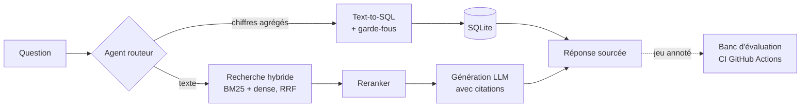

# DocQA-Bench

**Un assistant de questions-réponses sur documents, qui cite ses sources et mesure sa propre qualité.**


La plupart des démos RAG s'arrêtent à « ça a l'air de marcher ». DocQA-Bench part du principe inverse :
chaque amélioration du pipeline doit être **mesurée** sur un jeu de questions annotées, et la CI refuse
toute régression.

- **Recherche hybride** : BM25 + embeddings, fusionnés par Reciprocal Rank Fusion, puis **reranking**
- **Citations vérifiables** : chaque réponse renvoie au document et à la page exacts
- **Agent routeur RAG / SQL** : les questions chiffrées (évolutions, moyennes, totaux) partent vers une base SQL,
  avec garde-fous (SELECT uniquement, table autorisée)
- **Banc d'évaluation** : exactitude, recall@k, exactitude des citations, fidélité, taux d'hallucination, routage, latence
- **Production** : API FastAPI, interface web, Docker, CI GitHub Actions qui relance l'évaluation à chaque commit
- **Fonctionne sans clé d'API** (mode extractif hors ligne) ; branchez n'importe quel LLM compatible OpenAI
  (OpenAI, Mistral, Groq, Ollama en local)

## Architecture



## Démarrage rapide

```bash
git clone https://github.com/MohamedAnasBenMim/docqa-bench.git && cd docqa-bench
docker compose up --build          # puis ouvrir http://localhost:8000
```

Sans Docker :

```bash
pip install -r requirements-dev.txt
uvicorn docqa.api:app --reload     # API + interface sur http://localhost:8000
pytest                             # tests
python -m eval.run_eval            # évaluation des 3 variantes -> eval/results/results.md
```

Avec un LLM (exemple Mistral) :

```bash
export LLM_API_KEY=...  LLM_BASE_URL=https://api.mistral.ai/v1  LLM_MODEL=mistral-small-latest
```

Avec de vrais modèles d'embeddings et de reranking :

```bash
pip install sentence-transformers
export DOCQA_EMBEDDINGS=intfloat/multilingual-e5-small DOCQA_RERANKER=BAAI/bge-reranker-v2-m3
```

## API

```bash
curl -X POST localhost:8000/ask -H 'Content-Type: application/json' \
     -d '{"question": "Évolution du chiffre d'"'"'affaires entre 2023 et 2025 ?"}'
```

Réponse : `answer`, `citations`, `passages` (avec scores), `route` (`rag` ou `sql`), `variant`.

## Résultats

### Corpus de démonstration (fictif, 25 questions, mode extractif sans LLM)

Ces chiffres valident le pipeline et servent de référence en CI. Le corpus est volontairement petit :
les trois variantes y sont presque équivalentes.

| Variante | Exactitude | Recall@4 | Citations exactes | Fidélité | Hallucination ↓ | Routage |
|---|---|---|---|---|---|---|
| naive | 96 % | 100 % | 100 % | 100 % | 33 % | 100 % |
| hybrid | 96 % | 100 % | 100 % | 100 % | 33 % | 100 % |
| hybrid_rerank | 96 % | 100 % | 96 % | 100 % | 33 % | 100 % |

Le taux d'hallucination de 33 % (1 question sans réponse sur 3) illustre la limite du mode extractif :
il ne sait pas s'abstenir. C'est exactement ce que le passage à un LLM doit corriger.

### Corpus réel

*À compléter* : rapports annuels publics d'entreprises françaises cotées, ~100 questions annotées.
Voir [`scripts/README.md`](scripts/README.md).

## Métriques

| Métrique | Définition |
|---|---|
| Exactitude | la réponse contient tous les faits attendus |
| Recall@k | au moins un passage de la bonne page figure dans les k passages retrouvés |
| Citations exactes | la réponse cite au moins une page attendue, et aucune page hors sujet |
| Fidélité | chaque nombre de la réponse figure dans les passages cités |
| Hallucination | réponse donnée à une question dont la réponse n'est pas dans les documents |
| Routage | la question est envoyée au bon outil (RAG ou SQL) |

## Structure

```
docqa/        ingestion, recherche, reranking, génération, SQL, agent, API
eval/         questions annotées, métriques, script d'évaluation
data/sample/  corpus de démonstration fictif + données financières
tests/        tests unitaires et d'API
```

## Feuille de route

- [x] Recherche BM25, dense et hybride (RRF) + reranking
- [x] Citations au niveau page, agent routeur RAG/SQL avec garde-fous
- [x] Banc d'évaluation + seuil de non-régression en CI
- [ ] Corpus réel (rapports annuels publics) et ~100 questions annotées
- [ ] Comparaison chiffrée des variantes avec `multilingual-e5` et `bge-reranker`
- [ ] Juge LLM pour la fidélité des réponses en langage naturel
- [ ] Découpage hiérarchique (sections → paragraphes) et OCR pour les PDF scannés

## Licence

MIT
