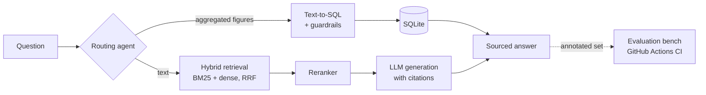

# DocQA-Bench

**A document question-answering assistant that cites its sources and measures its own quality.**


Most RAG demos stop at "it seems to work". DocQA-Bench takes the opposite approach:
every pipeline improvement must be **measured** against a set of annotated questions, and CI rejects
any regression.

- **Hybrid retrieval**: BM25 + embeddings, merged with Reciprocal Rank Fusion, followed by **reranking**
- **Verifiable citations**: every answer points to the exact document and page
- **RAG / SQL routing agent**: numerical questions (trends, averages, totals) are sent to a SQL database,
  with guardrails (SELECT only, allow-listed table)
- **Evaluation bench**: accuracy, recall@k, citation accuracy, faithfulness, hallucination rate, routing, latency
- **Production setup**: FastAPI API, web interface, Docker, GitHub Actions CI that re-runs the evaluation on every commit
- **Works without an API key** (offline extractive mode); plug in any OpenAI-compatible LLM
  (OpenAI, Mistral, Groq, local Ollama)

## Architecture



## Quick start

```bash
git clone https://github.com/MohamedAnasBenMim/docqa-bench.git && cd docqa-bench
docker compose up --build          # then open http://localhost:8000
```

Without Docker:

```bash
pip install -r requirements-dev.txt
uvicorn docqa.api:app --reload     # API + interface at http://localhost:8000
pytest                             # tests
python -m eval.run_eval            # evaluate the 3 variants -> eval/results/results.md
```

With an LLM (Mistral example):

```bash
export LLM_API_KEY=...  LLM_BASE_URL=https://api.mistral.ai/v1  LLM_MODEL=mistral-small-latest
```

With real embedding and reranking models:

```bash
pip install sentence-transformers
export DOCQA_EMBEDDINGS=intfloat/multilingual-e5-small DOCQA_RERANKER=BAAI/bge-reranker-v2-m3
```

## API

```bash
curl -X POST localhost:8000/ask -H 'Content-Type: application/json' \
     -d '{"question": "Évolution du chiffre d'"'"'affaires entre 2023 et 2025 ?"}'
```

Response: `answer`, `citations`, `passages` (with scores), `route` (`rag` or `sql`), `variant`.

## Results

### Demo corpus (fictional, 25 questions, extractive mode without an LLM)

These figures validate the pipeline and serve as the CI baseline. The corpus is deliberately small,
so the three variants perform almost identically on it.

| Variant | Accuracy | Recall@4 | Exact citations | Faithfulness | Hallucination ↓ | Routing |
|---|---|---|---|---|---|---|
| naive | 96% | 100% | 100% | 100% | 33% | 100% |
| hybrid | 96% | 100% | 100% | 100% | 33% | 100% |
| hybrid_rerank | 96% | 100% | 96% | 100% | 33% | 100% |

The 33% hallucination rate (1 unanswerable question out of 3) highlights the limitation of extractive mode:
it cannot abstain. This is exactly what switching to an LLM is meant to fix.

### Real-world corpus

*To be completed*: public annual reports from French listed companies, ~100 annotated questions.
See [`scripts/README.md`](scripts/README.md).

## Metrics

| Metric | Definition |
|---|---|
| Accuracy | the answer contains all expected facts |
| Recall@k | at least one passage from the correct page appears in the top-k retrieved passages |
| Exact citations | the answer cites at least one expected page and no irrelevant page |
| Faithfulness | every number in the answer appears in the cited passages |
| Hallucination | an answer is given to a question whose answer is not in the documents |
| Routing | the question is sent to the right tool (RAG or SQL) |

## Project structure

```
docqa/        ingestion, retrieval, reranking, generation, SQL, agent, API
eval/         annotated questions, metrics, evaluation script
data/sample/  fictional demo corpus + financial data
tests/        unit and API tests
```

## Roadmap

- [x] BM25, dense and hybrid (RRF) retrieval + reranking
- [x] Page-level citations, RAG/SQL routing agent with guardrails
- [x] Evaluation bench + non-regression threshold in CI
- [ ] Real-world corpus (public annual reports) and ~100 annotated questions
- [ ] Quantitative comparison of variants with `multilingual-e5` and `bge-reranker`
- [ ] LLM-as-a-judge for faithfulness of natural-language answers
- [ ] Hierarchical chunking (sections → paragraphs) and OCR for scanned PDFs

## License

MIT
